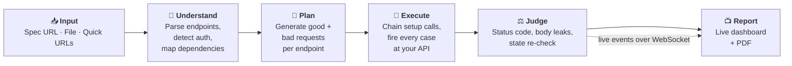
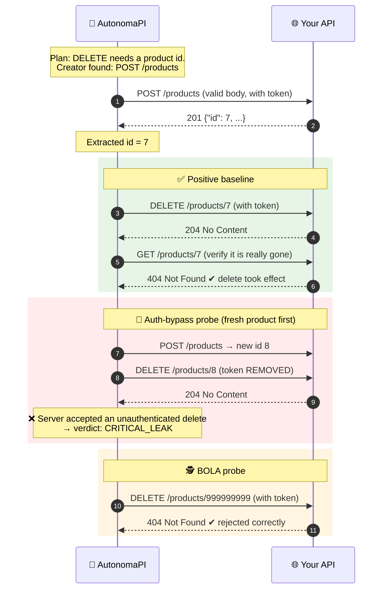
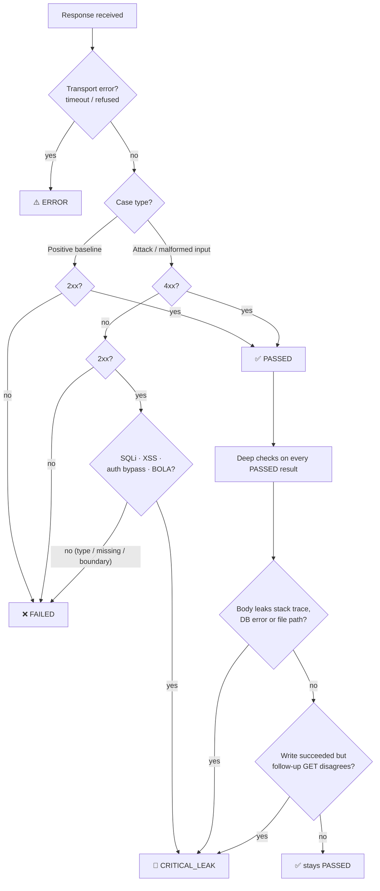
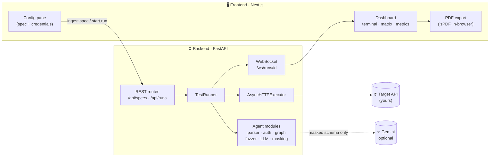

<div align="center">

# 🤖 AutonomaPI

### An autonomous AI agent that tests your API for you.

Give it an OpenAPI/Swagger spec (or just a few URLs). It figures out how your endpoints depend on each other, attacks them like a security tester would, reads the *actual* responses, and shows you every decision live on a dashboard.


</div>

---

## 📖 Table of Contents

1. [What is AutonomaPI? (the 30-second version)](#-what-is-autonomapi-the-30-second-version)
2. [What you get](#-what-you-get)
3. [**How it works**](#-how-it-works)
   - [The big picture](#1-the-big-picture)
   - [The 7 stages of a run](#2-the-7-stages-of-a-run)
   - [A worked example, step by step](#3-a-worked-example-step-by-step)
   - [What attacks does it send?](#4-what-attacks-does-it-send)
   - [How it decides pass / fail / critical](#5-how-it-decides-pass--fail--critical)
   - [Beyond the status code](#6-beyond-the-status-code-what-makes-it-different)
4. [Quick start](#-quick-start)
5. [Try it on the demo API](#-try-it-on-the-demo-api-see-it-catch-a-real-bug)
6. [Architecture & project structure](#-architecture--project-structure)
7. [Configuration](#-configuration)
8. [API reference](#-api-reference)
9. [Privacy & data masking](#-privacy--data-masking)
10. [Known limitations](#-known-limitations)
11. [Roadmap](#-roadmap)
12. [Responsible use](#-responsible-use)
13. [Glossary](#-glossary)

---

## 🎯 What is AutonomaPI? (the 30-second version)

When you build an API, you have to test it. Most hand-written tests only check *"does the happy path return 200?"* and maybe a couple of bad inputs. But the bugs that actually hurt are sneakier:

- 🔓 An endpoint **documented as "login required"** that never really checks the token.
- 💥 A `200 OK` response that **leaks a stack trace** or a file path.
- 🪤 An `UPDATE` that returns **"success" but changes nothing**.
- 🧨 An endpoint that happily accepts `' OR 1=1 --` as a product name.

**AutonomaPI acts like a tireless QA + security engineer.** It reads your API's description, creates real test data, throws hundreds of well-aimed good and bad requests at every endpoint, and reports exactly which ones misbehaved — in minutes, with no test code written.

| Without AutonomaPI | With AutonomaPI |
|---|---|
| Write tests endpoint by endpoint | Paste a spec URL, click one button |
| Manually create a user before testing `DELETE /users/{id}` | Agent chains `POST /users` → `DELETE /users/{id}` automatically |
| Think up attack payloads yourself | Built-in fuzzing, plus optional AI-designed attacks per field |
| Only check status codes | Also reads response bodies and re-fetches data to verify changes |
| Results in a terminal log | Live dashboard + one-click PDF report |

---

## ✨ What you get

| | Feature | What it does |
|---|---|---|
| 📥 | **3 ways to load an API** | Swagger/OpenAPI **URL**, **file upload** (`.json` / `.yaml` / `.yml`, Swagger 2.0 & OpenAPI 3.x), or **Quick Test** — just paste endpoint URLs, no spec needed |
| 🔑 | **Smart auth detection** | Reads the spec's security schemes (Bearer, Basic, API key in header/query, OAuth2) and shows only the credential inputs you actually need. Public endpoints skip auth automatically |
| 🔗 | **Dependency chaining** | To test `DELETE /products/{id}`, it first calls `POST /products`, grabs the real `id` from the response, and plugs it into the URL — recursively for nested resources |
| 🧪 | **Positive + negative testing** | One valid baseline request per endpoint, plus wrong types, missing fields, empty/huge values, **SQL injection** and **XSS** probes |
| 🧠 | **Optional AI-designed attacks** | With a Gemini API key, the agent proposes *field-aware* attacks (negative `quantity`, `role` → `"admin"`, currency mix-ups). No key? It silently falls back to the built-in fuzzer |
| 🚪 | **Auth-bypass probe** | Replays each protected request *without credentials*. If the server still says 2xx → critical finding |
| 🕵️ | **BOLA probe** | Replays requests against an id that doesn't belong to you / doesn't exist to test object-level authorization |
| 📄 | **Response-body leak detection** | Even on "successful" responses, scans for stack traces, DB errors and internal file paths |
| ✅ | **State-change verification** | After a successful `PUT`/`PATCH`/`DELETE`, re-fetches the resource to confirm it *really* changed |
| 📺 | **Live dashboard** | Streaming "agent thinking" terminal, real-time test matrix and metric cards over WebSockets |
| 📑 | **Executive PDF report** | One-click export, generated entirely in your browser |
| 🛡️ | **On-box data masking** | Tokens, JWTs, emails, card-like numbers are scrubbed before logs, reports or any LLM prompt |

---

## ⚙️ How it works

### 1. The big picture



Think of it as four questions the agent answers in order:

1. **What does this API look like?** → parse the spec into a clean list of endpoints.
2. **What do I need to test each one?** → credentials, and real ids created by other endpoints.
3. **What should I send?** → one valid request and many hostile ones.
4. **Did it behave correctly?** → judge status codes *and* what's inside the response.

### 2. The 7 stages of a run

| # | Stage | What happens | Code |
|---|---|---|---|
| **1** | **Ingest** | The spec is loaded from a URL, file, or hand-typed endpoints. `$ref` pointers are resolved and every route is flattened into a simple `EndpointSpec` (method, path, parameters, body schema, required auth). | `spec_parser.py` |
| **2** | **Detect auth** | Security schemes become UI inputs ("Bearer Token", "API Key (X-API-Key)"…). Each endpoint is classed as **public** (no credential sent) or **protected** (credential injected). | `auth_detector.py` |
| **3** | **Map dependencies** | Endpoints are grouped by resource (`/products`, `/orders`…). For any path like `/products/{product_id}`, the agent finds the endpoint that *creates* that resource (usually `POST /products`) and which response field holds the id. | `dependency_graph.py` |
| **4** | **Provision test data** | Before testing, the agent runs the setup chain for real, e.g. `POST /products` → reads `id` from the response → remembers it for the path parameter. | `test_runner.py` |
| **5** | **Generate cases** | Builds a valid baseline body from the schema, then a set of negative bodies — either from the built-in fuzzer or, if a Gemini key is set, AI-designed ones. | `payload_generator.py`, `llm_case_generator.py` |
| **6** | **Execute & judge** | Every case is sent through one HTTP client. Each response gets a verdict, then is double-checked for leaks and for fake "success" on writes. | `test_runner.py`, `leak_detector.py` |
| **7** | **Stream & report** | Every thought, result and metric is pushed live over a WebSocket to the dashboard. When the run ends you can export a PDF. | `ws/`, `reasoning_agent.py`, `lib/pdf-report.ts` |

> **Order inside each endpoint:** setup chain → ✅ positive baseline → 🧪 negative cases → 🚪 auth-bypass (protected only) → 🕵️ BOLA probe (path-param endpoints only).

### 3. A worked example, step by step

Let's follow what AutonomaPI does for **one** endpoint from the bundled demo API: `DELETE /products/{product_id}` (protected by a bearer token).



What happened here, in plain words:

1. **Chaining** — the agent knew it couldn't just delete "some id", so it *created* a product first and used the real id.
2. **Fresh resource per case** — `DELETE` destroys what it acts on, so every `DELETE` test gets its own newly created product. Otherwise later tests would get a meaningless 404.
3. **State verification** — a `204` isn't trusted blindly. The agent does a `GET` to confirm the product is gone.
4. **Auth bypass** — the same request with the token stripped *succeeded*. The docs said "protected", the code didn't enforce it. That's the planted bug in the demo API, and AutonomaPI flags it as **CRITICAL_LEAK**.
5. **BOLA** — it tried a nonexistent id (`999999999`) and correctly got rejected.

And in the dashboard's reasoning terminal you'd see the agent narrate along the way:

```text
THOUGHT  Analyzing route mapping...
INFO     Parsed 'ShopEase API' v1.2.0: 9 endpoints across 3 resources.
THOUGHT  Security scan complete — 6 protected endpoint(s), 3 public endpoint(s) will bypass auth automatically.
THOUGHT  Chaining dependency found: POST /products -> DELETE /products/{product_id}
INFO     Generated 1 positive and 0 negative case(s) for DELETE /products/{product_id}.
SUCCESS  DELETE /products/7 -> 204 [passed]
ERROR    DELETE /products/8 -> 204 [critical_leak]
WARNING  CRITICAL: Request replayed with the Authorization/API-key credential stripped — server returned 204 instead of rejecting the request
```
<sub>Illustrative log; exact counts and ids depend on your spec and run.</sub>

### 4. What attacks does it send?

For every endpoint that has a request body, the built-in fuzzer mutates **one field at a time** (so you can tell exactly which field caused a problem):

| Category | Example | A healthy API should… |
|---|---|---|
| `type_mismatch` | `"price": "not-a-number"` or `"name": 12345` | reject with `4xx` |
| `missing_required` | omit a required field | reject with `4xx` |
| `boundary` | empty string, 10,000-char string, `-1`, `999999999`, completely empty body `{}` | reject with `4xx` |
| `sql_injection` | `' OR 1=1 --`, `'; DROP TABLE users; --`, `' UNION SELECT NULL,NULL--` | reject with `4xx` |
| `xss` | `<script>alert(1)</script>`, `">` | reject with `4xx` |
| `auth_bypass` | valid request, credentials removed | reject with `401/403` |
| `bola` | valid request against id `999999999` | reject with `4xx` (e.g. `404`) |

The set is shuffled and capped by `MAX_NEGATIVE_CASES_PER_ENDPOINT` (default 50) so huge schemas don't explode.

**With a Gemini key** (optional), the model sees *only* the endpoint's schema and a masked example body and designs smarter, business-aware attacks instead — e.g. a negative `quantity` on an order, a `role` field pushed to `"admin"`, a self-referencing id, a unicode edge case. These show up in the dashboard tagged `[AI]`. If the model call fails for any reason, the run continues with the built-in fuzzer — a test run never stalls on the LLM.

### 5. How it decides pass / fail / critical



| Verdict | Meaning |
|---|---|
| ✅ **passed** | The API behaved correctly for that case |
| ❌ **failed** | Wrong behavior (e.g. valid input rejected, or malformed input accepted / `5xx`) |
| 🚨 **critical_leak** | Likely security problem: an attack was accepted, internals leaked, or a write silently did nothing |
| ⚠️ **error** | Couldn't get a response (timeout / connection error) |

The dashboard's **success rate** is `passed / total`, shown next to the counts of failures, critical leaks and errors.

### 6. Beyond the status code (what makes it different)

A basic tester stops at "got a 200, great." AutonomaPI does what a careful human would:

- **Reads the body.** A `200` containing `Traceback (most recent call last)`, `SQLSTATE[...]`, `ORA-12345`, or a path like `C:\app\...` / `/var/www/...` is escalated to `critical_leak`.
- **Verifies writes.** After a `PUT`/`PATCH`, it re-fetches the resource and compares what you sent with what's stored. After a `DELETE`, it checks the resource is really gone.
- **Never softens a verdict.** These deeper checks can only make a result *stricter*, never turn a real rejection into a pass.
- **Keeps going.** One broken endpoint or failed setup call is logged and skipped; it never aborts the whole run.

---

## 🚀 Quick start

### Prerequisites

- **Python 3.10+**
- **Node.js 20+** and npm

### 1) Start the backend

```bash
cd backend
python -m venv .venv
# Windows:        .venv\Scripts\activate
# macOS / Linux:  source .venv/bin/activate
pip install -r requirements.txt

cp .env.example .env          # Windows: copy .env.example .env
python -m uvicorn app.main:app --reload --port 8000
```

✔ Check it's alive: <http://localhost:8000/health> · Interactive API docs: <http://localhost:8000/docs>

### 2) Start the frontend

```bash
cd frontend
npm install
cp .env.local.example .env.local    # Windows: copy .env.local.example .env.local
npm run dev
```

✔ Open the dashboard: <http://localhost:3000>

### 🪟 Windows shortcut

After installing dependencies once, double-click **`run-all.bat`** — it opens the backend and frontend in two terminals.

### Using the dashboard

1. **Load an API** — choose *Spec URL*, *Upload File*, or *Quick Test*.
2. **Enter credentials** — only the fields your spec actually requires appear.
3. Click **Launch Autonomous Test Run**.
4. Watch the **reasoning terminal**, **test matrix** and **metric cards** update live.
5. Export the **PDF report** when it finishes.

---

## 🧪 Try it on the demo API (see it catch a real bug)

`sample-api/` is **ShopEase**, a small product & order API built purely as a test target. It contains one **intentional vulnerability**: `DELETE /products/{product_id}` is documented as requiring a bearer token, but the code never checks it.

```bash
cd sample-api
pip install -r requirements.txt
python -m uvicorn app:app --port 9000
```

Then in the AutonomaPI dashboard:

1. **Spec URL** → `http://localhost:9000/openapi.json` (a copy lives at `sample-api/shopease-openapi.json`)
2. Bearer token → `shopease-secret-token123` *(demo-only token)*
3. Click **Launch Autonomous Test Run**

🎯 **Expected result:** the auth-bypass case on `DELETE /products/{product_id}` is reported as **`critical_leak`**. The demo also exercises chaining: `POST /products → GET/PUT/DELETE /products/{id}` and `POST /products → POST /orders → GET/DELETE /orders/{id}`.

### Quick Test mode (no spec at all)

Don't have an OpenAPI doc? Switch to **Quick Test**, add endpoint URLs (method can be `auto`, detected via an `OPTIONS` request), optionally paste an example JSON body and a shared bearer token. Mark an endpoint **public** to skip auth-bypass scoring for it. Everything downstream — chaining, fuzzing, auth checks — works exactly the same.

---

## 🏗️ Architecture & project structure



```
AutonomaPI/
├── backend/                     # FastAPI service — the agent
│   ├── app/
│   │   ├── agent/
│   │   │   ├── spec_parser.py        # Swagger 2.0 / OpenAPI 3.x loader, $ref resolution
│   │   │   ├── auth_detector.py      # security schemes → UI fields & auth headers
│   │   │   ├── dependency_graph.py   # resource grouping, creator lookup, chain plans
│   │   │   ├── payload_generator.py  # Faker-based valid payloads + negative fuzz set
│   │   │   ├── llm_case_generator.py # optional Gemini field-aware attacks
│   │   │   ├── leak_detector.py      # stack-trace / DB-error / path signatures
│   │   │   ├── masking.py            # DataMasker (secrets & PII scrubbing)
│   │   │   ├── reasoning_agent.py    # narrates decisions into the live log
│   │   │   └── schema_inference.py   # infers a schema from an example body (Quick Test)
│   │   ├── api/routes/          # upload.py · run.py · stream.py
│   │   ├── executor/            # test_runner.py (orchestrator) · http_client.py
│   │   ├── schemas/             # Pydantic models for specs and results
│   │   ├── ws/                  # WebSocket connection manager
│   │   ├── core/                # settings, logging
│   │   ├── state.py             # in-process spec & run stores
│   │   └── main.py
│   ├── .env.example
│   └── requirements.txt
├── frontend/                    # Next.js dashboard
│   ├── app/                     # page.tsx, layout.tsx
│   ├── components/              # config-pane/ · dashboard/ · ui/
│   ├── hooks/use-run-stream.ts  # WebSocket consumer
│   └── lib/                     # API client, types, PDF report, formatters
├── sample-api/                  # "ShopEase" demo API with a planted bug
├── run-all.bat                  # Windows: launch both services
└── README.md
```

**Tech stack:** Python · FastAPI · Uvicorn · httpx · Pydantic v2 · PyYAML · Faker · python-dotenv &nbsp;|&nbsp; Next.js 16 · React 19 · TypeScript · Tailwind CSS 4 · Base UI · lucide-react · jsPDF &nbsp;|&nbsp; WebSockets &nbsp;|&nbsp; optional Google Gemini (plain REST, no SDK).

---

## 🔧 Configuration

### Backend — `backend/.env`

| Variable | Default | Description |
|---|---|---|
| `CORS_ORIGINS` | `http://localhost:3000` | Comma-separated frontend origins allowed to call the backend |
| `REQUEST_TIMEOUT_SECONDS` | `15` | Timeout for each test request |
| `MAX_NEGATIVE_CASES_PER_ENDPOINT` | `50` | Cap on negative cases per endpoint |
| `GEMINI_API_KEY` | *(empty)* | **Optional.** Enables AI-designed attacks. Free key: <https://aistudio.google.com/app/apikey> |
| `GEMINI_MODEL` | see `.env.example` | Gemini model used for case generation |

> Without `GEMINI_API_KEY` the tool is fully functional — it just uses the built-in fuzzer.

### Frontend — `frontend/.env.local`

| Variable | Default | Description |
|---|---|---|
| `NEXT_PUBLIC_API_BASE_URL` | `http://localhost:8000` | Where the dashboard finds the backend |

---

## 📡 API reference

Full interactive docs at <http://localhost:8000/docs>.

| Method | Path | Purpose |
|---|---|---|
| `GET` | `/health` | Liveness check |
| `POST` | `/api/specs/from-url` | Ingest a spec by URL — `{ "url": "..." }` |
| `POST` | `/api/specs/from-file` | Ingest an uploaded `.json` / `.yaml` / `.yml` spec (multipart) |
| `POST` | `/api/specs/quick` | Build a spec from hand-described endpoints (optional shared token, per-endpoint `public` flag) |
| `POST` | `/api/runs` | Start a run — `{ "spec_id", "credentials": { "<scheme>": "<secret>" } }` → `{ "run_id" }` |
| `GET` | `/api/runs/{run_id}` | Snapshot of status, metrics and results (handy after a page refresh) |
| `WS` | `/ws/runs/{run_id}` | Live events: `log` · `result` · `metrics` · `status` |

Typical flow: **ingest a spec → get `spec_id` → start a run → open the WebSocket with `run_id`.**

---

## 🔒 Privacy & data masking

Masking runs **entirely locally** (no network calls) via `DataMasker`:

- Bearer tokens, JWTs, `sk-…` style keys, email addresses and 13–16 digit runs → `[MASKED]`
- JSON keys like `password`, `token`, `authorization`, `api_key`, `secret`, `ssn`, `cvv` are masked by name
- Log lines and response snippets are masked before being stored or broadcast
- The optional LLM receives **only** the endpoint's schema and a masked example body — **never credentials or real response data**

---

## ⚠️ Known limitations

Honest scope, so you know what to expect:

- **In-memory state.** Specs and runs live in process memory; restarting the backend clears them. Built for single-instance dev/demo use — add Redis or a DB before running multiple workers.
- **Structured specs only.** PDF / Markdown / free-text API docs aren't parsed yet (JSON/YAML Swagger & OpenAPI, plus Quick Test).
- **Heuristic chaining.** Creators are found by resource name and `POST`/`GET` conventions; ids by `id`/`uuid`-like response fields. Unusual APIs may need Quick Test or may log failed setup calls.
- **Black-box checks.** Verdicts rely on HTTP behavior; a `4xx` counts as correct rejection without inspecting the error body.
- **Not a full pen-test.** The payload list and leak regexes are a solid baseline, not a replacement for a dedicated DAST/security audit.
- **No automated test suite yet** for AutonomaPI itself.

## 🗺️ Roadmap

- [ ] PDF / Markdown / free-text API documentation ingestion
- [ ] Persistent run history (database) and multi-worker support
- [ ] CI mode: CLI runner with exit codes and JUnit/JSON output
- [ ] OAuth2 token acquisition flows
- [ ] More probes: rate limiting, mass assignment, cross-user IDOR
- [ ] Unit & integration tests for the agent modules

## 🛑 Responsible use

AutonomaPI sends **real, intentionally hostile requests** — including destructive `DELETE`s and injection payloads — to whatever URLs you give it.

- ✅ Only test APIs **you own or have explicit permission to test**.
- ✅ Prefer a **staging / test environment**; never point it at production data.
- ✅ Never commit `.env` files or API keys (they're git-ignored here).

## 📚 Glossary

| Term | Plain-English meaning |
|---|---|
| **OpenAPI / Swagger** | A standard file (JSON/YAML) that describes every endpoint an API offers |
| **Endpoint** | One URL + method, like `POST /products` |
| **Positive test** | A valid request that *should* succeed |
| **Negative test** | A bad/malicious request that *should be rejected* |
| **Fuzzing** | Automatically sending lots of unusual or invalid inputs to find weaknesses |
| **SQL injection** | Smuggling database commands into an input field |
| **XSS** | Smuggling a script into content that a browser might later run |
| **Auth bypass** | Using a protected endpoint without valid credentials |
| **BOLA** (Broken Object Level Authorization) | Accessing someone else's / a nonexistent object just by changing its id |
| **Dependency chaining** | Calling endpoints in order so one produces the data (like an id) the next needs |

---

<div align="center">

*Built with FastAPI, Next.js, and a healthy distrust of `200 OK`.*

</div>
